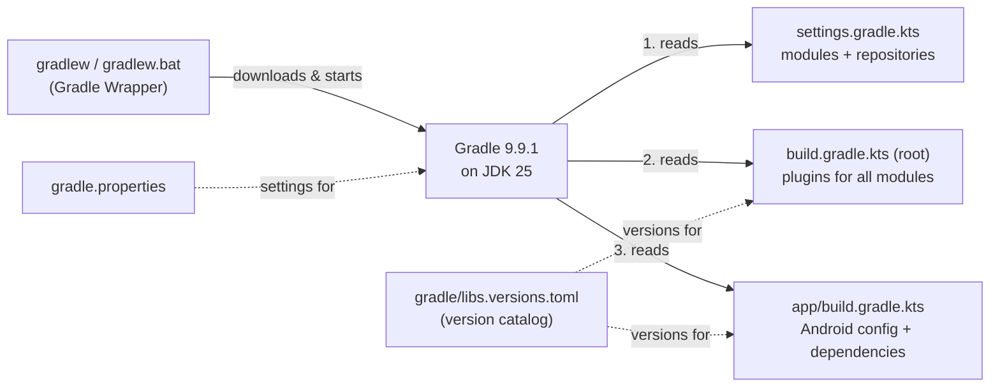

# Build Setup

> How the Gradle build is organized and what each file does. Last updated: 2026-11-17 (after the Phase 2 step 4 cleanup). Keep this file in sync whenever a build file changes.

## How a build runs



1. `gradlew` (the **Gradle Wrapper**) makes sure the right Gradle version is installed, then starts it.
2. Gradle reads `settings.gradle.kts` to learn which **modules** exist and where to download plugins and libraries from.
3. It then reads each module's `build.gradle.kts`, which applies plugins and declares dependencies. All versions come from the **version catalog**.

## Files

### `gradlew`, `gradlew.bat`, `gradle/wrapper/`: Gradle Wrapper

- Anyone who clones the repository runs `./gradlew <task>` (macOS/Linux/CI) or `gradlew <task>` (Windows) and gets **exactly the Gradle version in `gradle-wrapper.properties`**, with nothing to install.
- `distributionUrl` sets the Gradle version (9.9.1). `distributionSha256Sum` makes the wrapper verify the downloaded Gradle, so a tampered download is rejected.
- To upgrade Gradle, pass the official checksum (published next to each release, e.g. `https://services.gradle.org/distributions/gradle-X.Y.Z-bin.zip.sha256`), then run the task a second time so the scripts and jar are regenerated by the new version:
  ```bash
  ./gradlew wrapper --gradle-version X.Y.Z --gradle-distribution-sha256-sum <sha256>
  ./gradlew wrapper
  ```
- `gradle-wrapper.jar` is the small program that does the download. It is the one `.jar` that belongs in the repository.
- `gradlew` must keep LF line endings and the executable bit (`100755` in git) to run on Linux CI; `.gitattributes` takes care of the line endings.

### `settings.gradle.kts`: modules and repositories

Gradle reads this file first.

| Block | What it does |
|---|---|
| `pluginManagement { repositories { … } }` | Where Gradle **plugins** (e.g. the Android Gradle Plugin) are downloaded from. The `content { includeGroupByRegex(…) }` filter looks up only `com.android.*`, `com.google.*` and `androidx.*` on Google's repository: faster, and no other group can be served from there by mistake. |
| `plugins { id("org.gradle.toolchains.foojay-resolver-convention") }` | Lets Gradle **download a JDK automatically** (from the foojay API) when the build asks for one that isn't installed. |
| `dependencyResolutionManagement { … }` | Where **libraries** are downloaded from (Google Maven, Maven Central), declared once for all modules. `FAIL_ON_PROJECT_REPOS` fails the build if a module adds its own repository. |
| `rootProject.name = "color-picker"`, `include(":app")` | The project name and the list of modules. `:core:color` will be added here. |

### `gradle/libs.versions.toml`: version catalog

The **single place for dependency and plugin versions**.

| Section | Example | Used in build files as |
|---|---|---|
| `[versions]` | `agp = "9.5.1"` | referenced by `version.ref` |
| `[libraries]` | `androidx-core-ktx = { group = …, name = …, version.ref = "coreKtx" }` | `libs.androidx.core.ktx` (dashes become dots) |
| `[plugins]` | `android-application = { id = "com.android.application", version.ref = "agp" }` | `alias(libs.plugins.android.application)` |

The Compose libraries (`ui`, `material3`, …) have no version of their own: they get it from **`composeBom`**, a *Bill of Materials* that pins a set of Compose libraries tested together. A module applies it with `platform(libs.androidx.compose.bom)`.

All versions follow the rule in [TECH_STACK.md](TECH_STACK.md): latest **stable** release at the time of the change.

### `build.gradle.kts` (root)

- `plugins { … apply false }` declares the plugins used by the modules: "put them on the build's classpath once, and let each module decide whether to apply them".
- `buildscript { dependencies { classpath(libs.kotlin.gradle.plugin) } }` selects the **Kotlin version**. AGP 9 compiles Kotlin itself but bundles an older Kotlin Gradle plugin (2.2.10 in AGP 9.5.1); putting a newer one on the classpath replaces it, as [documented by Google](https://developer.android.com/build/releases/agp-9-0-0-release-notes#runtime-dependency-on-kotlin-gradle-plugin). The Compose compiler plugin uses the same `kotlin` version from the catalog, so the two always match.

Check the Kotlin version actually used with `./gradlew buildEnvironment` (look for `kotlin-gradle-plugin:2.2.10 -> 2.4.21`).

### `app/build.gradle.kts`: the app module

**Plugins**

- `android.application`: this module builds an app (an APK/AAB). A library module would use `android.library`, and a pure-Kotlin module like `:core:color` will use the Kotlin JVM plugin.
- `kotlin.compose`: the Compose compiler plugin.
- No separate Kotlin plugin: **AGP 9 compiles Kotlin itself** ("built-in Kotlin"). Older guides apply `org.jetbrains.kotlin.android`; this project doesn't need it.

**`android { … }`**

| Setting | Meaning |
|---|---|
| `namespace` | Package of the generated `R` class and of the code. Internal only; it can change at any time. |
| `applicationId` | The app's **identity** on the device and on Google Play. Same text as the namespace, but a separate setting. It becomes **permanent after the first Play upload** (see [NAMING.md](NAMING.md)). |
| `compileSdk { version = release(37) }` | The Android API the code is compiled against (AGP 9 block syntax). |
| `minSdk = 26` | Oldest Android version that can install the app (Android 8.0). |
| `targetSdk = 37` | The Android version whose behavior the app is tested against. Google Play requires a recent one. |
| `versionCode` / `versionName` | Integer that orders updates on Play (must grow with every upload) / version text shown to users, following [semantic versioning](https://semver.org) (`0.x` until the 1.0 release). |
| `testInstrumentationRunner` | The runner for on-device tests in `src/androidTest`. |
| `buildTypes { release { optimization { enable = true } } }` | **R8** on the whole app for release builds: code shrinking, optimization, obfuscation and resource shrinking, plus Google's default Android keep rules (AGP 9.3+ DSL, replacing `isMinifyEnabled`, `isShrinkResources` and `proguard-rules.pro`). Keep rules live in `app/src/main/keepRules/`. The template's `packageScope` (optimize only some packages) was removed: Google meant it as a gradual-migration aid for existing apps, and it left our own code unoptimized. Result: the release APK is ~0.8 MB against ~11.7 MB for debug. |
| `buildFeatures { compose = true }` | Enables Compose in this module. |

**`java { toolchain { languageVersion = JavaLanguageVersion.of(17) } }`**: the **Java toolchain**. Every machine (yours, CI) compiles with JDK 17, downloaded through foojay if missing, so builds don't depend on whichever JDK happens to be installed. It also sets the Java source/target compatibility and Kotlin's `jvmTarget` to 17, which is why there is no `compileOptions` block. Java 17 bytecode works on every supported Android version (D8 converts it to Android's DEX format); the Java *APIs* available still depend on `minSdk`.

**`dependencies { … }`**: configurations

| Configuration | Where the library ends up |
|---|---|
| `implementation` | Shipped in the app. |
| `testImplementation` | JVM unit tests only (`src/test`, run on the computer). |
| `androidTestImplementation` | Instrumented tests only (`src/androidTest`, run on a phone or emulator). |
| `debugImplementation` | Debug builds only, e.g. Compose preview tooling, so it never reaches release builds. |

### `gradle.properties`: Gradle settings

| Property | Meaning |
|---|---|
| `org.gradle.jvmargs=-Xmx2048m …` | Memory for the Gradle daemon. |
| `org.gradle.configuration-cache=true` | Gradle caches the result of reading the build scripts and skips that phase when they haven't changed. |
| `org.gradle.parallel=true` | Builds independent modules at the same time. Requires modules that don't configure each other. |
| `org.gradle.caching=true` | Build cache: reuses task outputs (e.g. compiled classes) from earlier builds, even after `clean` or a branch switch. |
| `org.gradle.tooling.parallel=true` | Lets Android Studio's Gradle sync fetch project models in parallel (Gradle 9.4+). Added by Android Studio itself; it doesn't affect command-line builds. |
| `kotlin.code.style=official` | The official Kotlin code style (also enforced by ktlint later). |

### `gradle/gradle-daemon-jvm.properties`: JDK that runs Gradle

Sets the JDK that **runs Gradle itself** (`toolchainVersion=25`), with download URLs per OS through foojay. It is separate from the JDK that **compiles the app's code** (the Java toolchain, 17, in `app/build.gradle.kts`): one is the build tool's runtime, the other produces the app's bytecode.

Three JDKs are involved, each with its own job:

| JDK | Set by | Job |
|---|---|---|
| Launcher JDK | `JAVA_HOME` (terminal) or Android Studio's Gradle JDK setting | Only starts `gradlew`, which hands over to the daemon |
| Daemon JDK (25) | `gradle/gradle-daemon-jvm.properties` | Runs Gradle and the build scripts |
| Toolchain JDK (17) | `java { toolchain }` in `app/build.gradle.kts` | Compiles Java/Kotlin and runs unit tests |

To run `gradlew` from a terminal, `JAVA_HOME` must point to a JDK, for example the one bundled with Android Studio: `C:\Program Files\Android\Android Studio\jbr`.

### `app/src/main/keepRules/rules.keep`: R8 keep rules

Rules that stop R8 from removing or renaming code that is only reached by reflection (e.g. a WebView JavaScript interface). AGP combines every file in `src/main/keepRules/`. Empty for now.

## Useful commands

```bash
./gradlew assembleDebug      # build a debug APK
./gradlew installDebug       # build and install on the connected phone
./gradlew test               # run JVM unit tests
./gradlew check              # all verification tasks (tests, lint; later formatting and detekt)
./gradlew dependencies --configuration releaseRuntimeClasspath   # what the release app ships
```

On Windows PowerShell, use `.\gradlew` instead of `./gradlew`.
