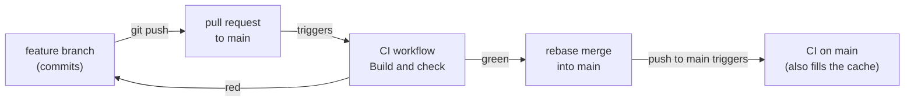

# Continuous Integration

> How GitHub checks every change before it reaches `main`. Last updated: 2026-11-24 (Phase 2 step 6). Keep this file in sync with `.github/workflows/ci.yml` and the repository settings.

## The flow of a change

1. Work happens on a short-lived branch, never directly on `main`.
2. A pull request to `main` starts the **CI** workflow. Every new push to the PR starts it again, and cancels the run that is still going.
3. GitHub allows the merge only when CI is green (see [Rules on `main`](#rules-on-main)).
4. The merge is a **rebase merge**: the PR's commits are replayed on top of `main` one by one, so the history stays a straight line.
5. The push to `main` runs CI once more, on the exact code that is now in `main`.

## The workflow: `.github/workflows/ci.yml`

| Part | What it does |
|---|---|
| `on: pull_request` / `push` to `main` | When it runs. |
| `permissions: contents: read` | The workflow's token can only read the repository: a compromised step couldn't push code or change settings. |
| `concurrency` | One run per branch. On pull requests a new push cancels the previous run; on `main` runs are never cancelled, so every commit there gets a result. |
| Job `build`, named **Build and check** | The one job. Its name is the status check the ruleset requires, so **renaming it means updating the ruleset too**. Runs on `ubuntu-latest`, with a 30-minute timeout. |

Steps of the job:

1. **`actions/checkout@v7`**: gets the code.
2. **`actions/setup-java@v6`**: installs Temurin JDK 17 and 25. The last one listed becomes `JAVA_HOME`, so Gradle runs on 25 (as `gradle/gradle-daemon-jvm.properties` asks). Gradle finds JDK 17 for the toolchain through the `JAVA_HOME_17_X64` variable that setup-java sets, so foojay downloads nothing.
3. **`gradle/actions/setup-gradle@v6`**:
   - Caches Gradle's downloads and build outputs between runs. Only runs on `main` **write** the cache; PR runs only read it, so short-lived branches don't fill it with entries nobody reuses. That means the first PR runs after the workflow was added run without a cache.
   - Validates `gradle/wrapper/gradle-wrapper.jar` against Gradle's official checksums. A tampered wrapper JAR is a known way to sneak code into a build.
4. **`./gradlew check assembleDebug`**: the same command you can run locally. `check` covers formatting, detekt, Android Lint and unit tests (see [BUILD.md](BUILD.md#code-quality)); `assembleDebug` proves the app still builds.
5. **Upload reports**, only if a step failed: the detekt, Lint and test reports are attached to the run as an artifact called `reports`, kept for 7 days.

The Android SDK comes preinstalled on GitHub's Ubuntu runners. AGP downloads any missing platform by itself.

### Action versions: major tags, not commit SHAs

The actions are referenced by **major version tag** (`@v7`), so bug fixes and security fixes arrive automatically and there is nothing to maintain.

The stricter alternative is pinning each action to a full commit SHA (`actions/checkout@3d3c42e… # v7.0.1`). A tag can be moved to different code, for example by an attacker who takes over the action's repository; a SHA can't. That's how the 2025 compromise of `tj-actions/changed-files` spread. SHA pinning needs a bot such as Dependabot to keep the SHAs current.

We use tags because all our actions come from GitHub itself or from Gradle. **Switch to SHAs + Dependabot if we add a third-party action, or when the project gets contributors.**

### When CI fails

1. Open the PR's **Checks** tab, or run `gh pr checks <number>`.
2. Read the failed step's log: `gh run view <run-id> --log-failed`.
3. For detekt, Lint or test failures, download the `reports` artifact from the run's page and open the HTML reports.
4. Reproduce locally with `./gradlew check assembleDebug`, fix, push again.

## Rules on `main`

### Merge options (Settings → General → Pull Requests)

- Only **rebase merging** is allowed. Merge commits and squash merging are off.
- **Automatically delete head branches**: GitHub deletes the PR's branch after the merge.

### Ruleset "Protect main" (Settings → Rules → Rulesets)

Targets the default branch, is **active**, and has **no bypass list**: nobody can skip it, administrators included.

| Rule | What it prevents |
|---|---|
| **Restrict deletions** | Deleting `main`. |
| **Block force pushes** | `git push --force` to `main`, which would rewrite or erase published history. |
| **Require linear history** | Merge commits on `main`. Changes must arrive as a straight line of commits (rebase merging). |
| **Require a pull request before merging** | Pushing commits to `main` directly: every change goes through a PR. Required approvals: **0**, because GitHub doesn't let authors approve their own PRs and the project has one developer. Allowed merge method: **rebase**. |
| **Require status checks to pass**: `Build and check` (from GitHub Actions) | Merging a PR whose CI is red, still running, or missing. The check is pinned to the GitHub Actions app, so nothing else can report a fake green check with the same name. |
| └ **Require branches to be up to date before merging** | Merging a PR that was tested against an older `main`. If `main` moved, GitHub asks to update the branch (**Update branch → rebase**), and CI runs again on the combined code. |

GitHub also enables **"Require an additional approval for unattributed Copilot pull requests"** by default. It only adds one approval to PRs opened by Copilot's coding agent, so it has no effect while required approvals are 0.

Docs: [Available rules for rulesets](https://docs.github.com/en/repositories/configuring-branches-and-merges-in-your-repository/managing-rulesets/available-rules-for-rulesets).

### Line endings

`.gitattributes` sets `* text=auto eol=lf`: text files are stored **and checked out** with LF on every machine, whatever each developer's `core.autocrlf` says. Without it, Windows checkouts get CRLF, Spotless expects CRLF locally, and new files created with LF (as `.editorconfig` asks) fail `spotlessCheck` on Windows but pass in CI.
