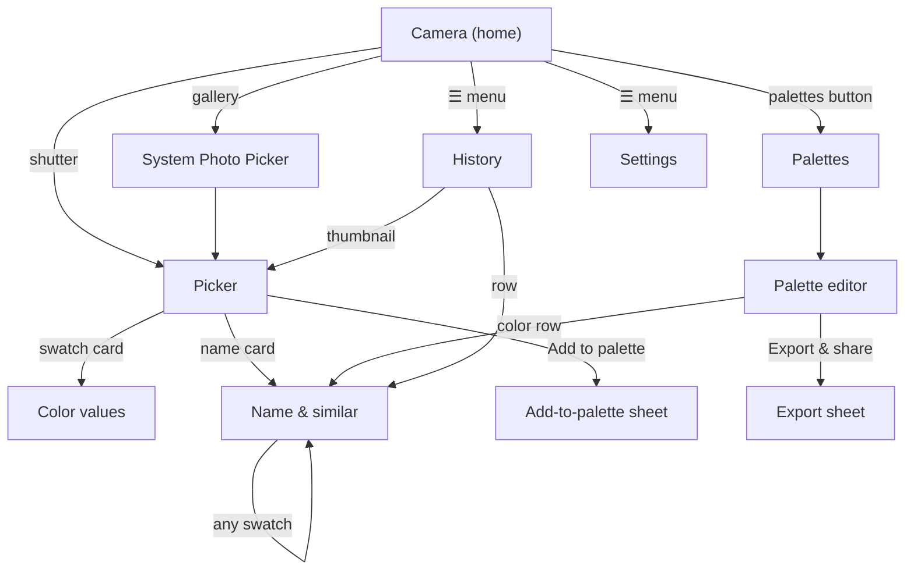

# Product Spec — Color Picker (working title)

> Living document. Last updated: 2026-11-17. Status: Phase 1 (product & design) complete, Phase 2 (project skeleton) in progress.

## 1. Vision

An Android **color picker for artists and designers**. Point the camera at anything (or open a photo), pick a color with pixel precision, learn its name and story, explore related colors, and collect palettes.

**What makes it different**
- **Evocative color names with a one-line description** for ~32,000 colors (from the open color.pizza dataset), instead of a bare HEX code.
- **Pixel-precise picking**: a fixed crosshair with the photo moving underneath, not a fingertip guess.
- **Built for creative work**: values in the formats designers use, contrast checks, harmonies; comparison, calibration and pro exports in later releases.

**Distribution**: free and open source, published on Google Play.

## 2. Principles

| Principle | What it means in practice |
|---|---|
| Colors first | The UI is neutral (pure greys, ink accent) so it never competes with, or biases, the picked colors. |
| Offline & private | Everything runs on the device. No accounts. Photos and palettes never leave the phone unless the user shares them. |
| Precise | Sampling is pixel-exact and the sample area is explicit (1px / 3×3 / 5×5). |
| Thumb-friendly | Primary actions sit in the bottom third of the screen. |
| Accessible | Text contrast meets WCAG AA, every control has a TalkBack label, touch targets ≥ 48dp. |

## 3. Users

- **Painters & illustrators**: pick colors from references, study them, build palettes for a painting.
- **Designers (UI, graphic, interior)**: capture colors from the real world, get exact values, check contrast, take palettes into their tools.

## 4. Platform & constraints

- Android only, native **Kotlin + Jetpack Compose**, `minSdk 26`, `targetSdk` = latest.
- Free and open source under **MPL-2.0** (file-level copyleft: our files stay open source, while the app may include files under other licenses, e.g. Mixbox's CC BY-NC 4.0 if paint mixing uses it). The app stays non-commercial: no ads, no paid features.
- Public GitHub repository from the first commit.
- No internet permission planned for 1.0 (all data is bundled).
- Tech stack and tooling: see [TECH_STACK.md](TECH_STACK.md); build setup: see [BUILD.md](BUILD.md).

## 5. Release 1.0 — scope

### 5.1 Getting a color
- **Camera (home screen)**: in-app camera (CameraX) opens at launch. 4:3 viewfinder with a center crosshair. **Shot first**: no live color reading; the shutter freezes the frame and opens the Picker.
  - Tap to focus, pinch to zoom, 1×/2× chips, flashlight, flip camera.
- **Gallery**: system Photo Picker (no storage permission). The gallery button shows the **last photo used in the app**, or a plain icon on first launch.
- **Camera permission flow**: explanation screen with *Grant access* and a gallery fallback when permission is missing or denied.

### 5.2 Picking (Picker screen)
- The photo is shown whole, keeping its aspect ratio (letterboxed), and can be panned and zoomed.
- **Fixed center crosshair**: the photo moves underneath it; the color under the crosshair is the picked color. The photo can be panned past its edges so every pixel can reach the crosshair.
- **Tap-to-jump**: tapping a spot animates it to the crosshair.
- **Magnifier**: a fixed magnifier next to the crosshair shows the surrounding pixels enlarged, with the sample area outlined.
- **Sample size chip**: 1px / 3×3 / 5×5 (average of the area).
- **Suggestion bubbles**: when a photo loads, the 5–8 dominant colors appear as bubbles placed where they occur in the photo. Tapping a bubble jumps it to the crosshair. Bubbles hide as soon as the user touches the photo; a **Suggestions chip** toggles them back.
- **Bottom sheet** with two states:
  - **Expanded (default, "Option B")**: swatch card (→ Color values), name card with name, tagline and 4 similar swatches (→ Name & similar), *Add to palette*, Copy HEX, Share.
  - **Collapsed ("Option A")**: one row with swatch, name, HEX, Copy, Add. The user swipes down to collapse and up to expand.

### 5.3 Understanding a color
- **Color values** (from the swatch card): HEX, RGB, HSL, HSV, CMYK, CIELAB, OKLCH, each copyable with a tap. **Contrast (WCAG)** of black and white text on the color, with AA/AAA grade.
- **Name & similar** (from the name card; one scrolling screen):
  - Split swatch: *your color* vs *the named color*, and a match chip (e.g. "very close match").
  - Name + **tagline** (color.pizza description).
  - **Similar names**: nearest named colors with taglines; each opens its own Name & similar screen.
  - **Tints, shades, tones**: 9-step strips.
  - **Harmonies**: complementary, analogous, triadic, split complementary.
  - Any swatch on this screen opens that color.

### 5.4 Palettes
- **Palettes list**: 2-column grid of cards (stripes, name, count, last edit); search, sort; *New palette* button; long-press multi-select (delete, duplicate); empty state.
- **Palette editor**: rename, stripe preview, drag to reorder, swipe to remove (with Undo), tap a color → Name & similar, *Add color* (from history / pick from a photo / type HEX), duplicate/delete in ⋮.
- **Export & share**: HEX list as text, image card (PNG), JSON, CSS variables.

### 5.5 History
- Every pick, newest first, grouped by day: swatch, name, HEX, time, **thumbnail of the source photo**.
- Tap a row → Name & similar. Tap the thumbnail → reopen that photo in the Picker at the picked spot.
- Long-press multi-select (add to palette, delete). *Clear history* with confirmation.
- A downscaled copy of each source photo is stored privately in app storage.

### 5.6 Settings & about
- Theme: system / light / dark. Default color format.
- About, **open-source licenses** (required attribution for the color datasets), privacy policy link.

## 6. Navigation

Inner screens only show ← (no hamburger). History and Settings live in the ☰ menu of the Camera screen.

## 7. Color data & algorithms

| Item | Source / method | License |
|---|---|---|
| Color names (~32,000) | [`color-name-list`](https://github.com/meodai/color-names) (v14.86.0 at time of writing) | MIT, attribution required |
| Taglines (one per name) | `data/taglines.json` in [`color-name-api`](https://github.com/meodai/color-name-api) (synced from names.color.pizza) | MIT (repo); see open question on separate terms |
| Closest name & similar names | Nearest neighbours by distance in **OKLab** | — |
| Dominant colors (suggestions) | Clustering of downscaled photo pixels in OKLab (e.g. k-means), keeping each cluster's location | — |
| Tints / shades / tones | Mix with white / black / grey | — |
| Harmonies | Hue rotation (to evaluate: HSL vs OKLCH) | — |
| Contrast | WCAG 2.x relative luminance ratio | — |

All conversion and color math lives in a pure-Kotlin `:core:color` module with unit tests. The datasets are bundled in the app (works offline).

**Match chip thresholds (proposal, ΔE in OKLab ×100)**: < 1 "very close match", < 2.5 "close match", < 5 "similar", otherwise "nearest available name".

## 8. Visual direction

- **Mood**: calm and minimal; the picked colors are the only strong color on screen.
- **Colors**: fixed brand theme (no wallpaper-based dynamic color). Accent = **monochrome ink** (#1B1B1F in light mode, inverted in dark mode). Surfaces are **pure neutral greys** (zero chroma): Material 3's default seed-tinted neutrals are overridden.
- **Type**: Inter everywhere; tabular figures for HEX and numeric values.
- **Shapes**: generous rounding (cards 16–20dp, sheets 28dp), Material 3 components.
- **Themes**: light and dark, following the system.
- **Icon**: the colorful identity lives in the app icon (to design once the app has a name). Adaptive + themed (monochrome) icon.

**Design files**: low-fi wireframes in the project's Figma file (private). Frames: original Camera/Picker, "Claude draft v2" (Camera v2, Picker v2 A/B, Color values, Name & similar), "Claude draft v3" (Palettes, Palette editor, History). The Picker frames still show the old finger-following loupe and need updating to the fixed crosshair (§5.2). Hi-fi mockups are skipped for now; the look is refined directly in Compose.

## 9. Non-functional requirements

- **Performance**: camera ready < 1s after launch on a mid-range phone (reference: moto g54 5G); suggestions computed in the background without blocking the UI; nearest-name lookup < 50ms.
- **Accessibility**: WCAG AA text contrast, TalkBack labels (including spoken color names), 48dp touch targets, supports font scaling.
- **Privacy**: no tracking, no network calls in 1.0; photos stored only in private app storage and deletable by clearing history.
- **Localization**: English at launch; Italian as a candidate second language. (Color names and taglines are English-only.)
- **Quality**: unit tests for `:core:color`, UI tests for main flows, screenshot tests for key screens, CI on every pull request.

## 10. Roadmap & future features

### 1.1 — "Compare & calibrate"
- **Comparison mode**: the screen is split in half, each half holding one color (from the camera, a photo, history or a palette). A middle strip shows the overall difference (ΔE, with a verdict such as "barely visible" / "clearly different") and its direction in plain words: lighter/darker, warmer/cooler, more/less saturated.
- **Grey-card calibration**: tap a neutral area (white paper, grey card) to correct the photo's white balance; picks from that photo are marked "calibrated".

### Later release — designer features
- **Pro exports**: Adobe Swatch Exchange (.ase), Procreate (.swatches), GIMP (.gpl), design tokens (JSON), SCSS, Tailwind, Android/Compose and SwiftUI code.
- **Colorblindness simulation** for a color, a palette or a photo.
- **Palette contrast matrix** (WCAG contrast of every pair).
- **Tonal scale generator** (50–900 scale in OKLCH) with export.
- **Gradients** interpolated in OKLCH.

### To study
- **Paint mixing suggestions**: "mix these 2–3 pigments to get this color". Study topics: libraries and pigment data with licenses compatible with an open-source app, solving from target color to recipe, realistic accuracy (paint brands, lighting, camera). Outcome: a go/no-go report, possibly with a prototype.

### Backlog (not scheduled)
- **Value view**: greyscale / posterize (3–5 values, notan) toggle on the Picker photo.
- **Grid overlay** on the Picker photo (grid drawing method).
- **Share-to-app**: receive images shared from other apps straight into the Picker.
- **Auto palette from a photo** (one tap: dominant colors → new palette).
- **Live camera picking** (color under the crosshair updated in real time).
- **Physical color systems** (RAL, marker and paint brands) — each needs a licensing check; Pantone data cannot be shipped.

## 11. Open questions

| # | Question | Notes |
|---|---|---|
| 1 | Show a plain everyday name (e.g. XKCD's ~950 names) as a secondary label? | Decide when building Name & similar. |
| 2 | Courtesy message to the color-name-list / color.pizza author before release? | Taglines have no separate stated license and their origin isn't documented. |
| 3 | Keep CMYK in Color values? | Without a print profile it is only approximate. |
| 4 | History retention: last N picks or N days? | e.g. 200 picks or 30 days. |
| 5 | Harmonies computed in HSL or OKLCH? | OKLCH is perceptually better; HSL is what most tools show. |
| 6 | App name and icon | Candidates in [NAMING.md](NAMING.md). Decide before the first Google Play upload; working app ID until then: `io.github.luigipionargiso.colorpicker`. |
| 7 | Crash reporting in 1.0? | Play Console vitals need no extra code; Crashlytics would add a network dependency (conflicts with §4). |

## 12. Decision log

| Date | Decision |
|---|---|
| 2026-11-09 | Android-only, native Kotlin + Compose; stack plan approved. |
| 2026-11-10 | MVP scope: gallery + camera photo, names, explore (similar, tints/shades/tones, harmonies, contrast), palettes (edit, export), history. |
| 2026-11-12 | App opens on an in-app camera, shot first. History and Settings in the ☰ menu. |
| 2026-11-12 | Gallery button thumbnail = last photo used in the app (avoids broad photo permission). |
| 2026-11-12 | Separate Color values and Name & similar screens; closest match and similar colors together. |
| 2026-11-12 | color.pizza taglines as a distinctive feature, bundled offline. |
| 2026-11-12 | Picker bottom sheet: Option B expanded by default, collapsible to Option A. |
| 2026-11-14 | Visual direction: calm & minimal, monochrome ink accent, neutral surfaces, Inter, light + dark. |
| 2026-11-14 | Picker: fixed center crosshair, photo moves underneath, tap-to-jump. |
| 2026-11-14 | Positioning: "for artists and designers". 1.1 = comparison + grey-card calibration; designer features later; paint mixing study postponed. |
| 2026-11-14 | The app will be free and open source. |
| 2026-11-14 | License: MPL-2.0 (keeps the code open source, compatible with including Mixbox). Repository public from the first commit. |
| 2026-11-24 | Code quality: detekt pinned to 2.0.0-alpha.6, an exception to the "latest stable" rule (the stable 1.23 doesn't support AGP 9 or Kotlin 2.4). It is a build-only tool; move to 2.0 stable on release. |
